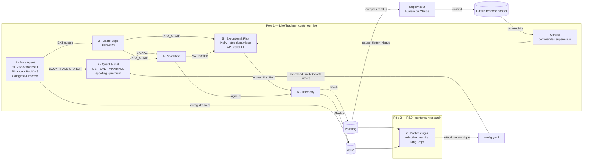

# hl-swarm — essaim multi-agents de trading sur Hyperliquid

Système autonome à 7 agents, dédié aux perps Hyperliquid. Il démarre **sur le testnet, en paper trading** (`dry_run: true`). Le passage en réel exige trois verrous explicites (voir [Sécurité](#sécurité)).

> ⚠️ Ce code n'est pas un conseil financier. La stratégie fournie est un **squelette de recherche** : elle n'a jamais été validée sur des données réelles. Faites-la tourner en paper trading, accumulez des enregistrements de marché, puis laissez l'agent R&D la recalibrer avant de risquer du capital.

## Architecture



**Choix de conception :**

- **L'avantage visé est le positionnement, pas la vitesse.** Le bot ne cherche pas à battre les market makers à la milliseconde. Il vise des mouvements de quelques minutes à une heure, et s'appuie sur ce qui est public sur Hyperliquid : funding extrême, clusters de liquidations, positions des gros portefeuilles. La microstructure (OBI, CVD) sert de filtre d'entrée.
- **Exécution maker par défaut.** Les ordres sont « post-only » : le bot pose son prix dans le carnet au lieu de prendre celui des autres. Les frais d'un aller-retour passent d'environ 9 bps à environ 3 bps (`execution.mode`).
- **Aucun LLM dans le chemin critique.** Du carnet au signal, tout est du numpy déterministe : environ 0,4 ms au p50 dans les tests. Le LLM (Perplexity Sonar) ne sert qu'au radar d'actualité de l'agent Macro. Il tourne en tâche de fond et ne peut **qu'augmenter** le niveau de risque.
- **Une seule implémentation de la stratégie.** `ml_engine/` (features, signal, politique d'entrée/sortie, sizing) est exécuté tel quel par le live **et** par le backtest. Un backtest qui utiliserait un autre code ne dirait rien du live.
- **Bus d'événements en mémoire** avec files bornées et politique « drop-oldest » : un agent lent ne bloque jamais les autres.
- **Stops côté exchange.** SL et TP sont des ordres *trigger reduce-only* posés sur Hyperliquid juste après l'entrée. Ils protègent la position même si le conteneur meurt.

### Correspondance avec le cahier des charges

Les « skills » et « connecteurs » cités dans la demande sont des outils de l'assistant. Ils n'existent pas dans un conteneur déployé. Voici comment chacun est implémenté dans le code :

| Demandé | Implémenté par |
|---|---|
| `build-connector` SDK Hyperliquid | `hyperliquid-python-sdk` (ordres) + WebSocket natif (`core/ws_client.py`) |
| Firecrawl heatmaps/liquidations | API Coinversa Pulse (défaut), Coinglass ou Firecrawl `/scrape` (`data.liquidations.provider`) |
| CoinGecko prix Binance/Bybit | WebSockets publics Binance USDⓈ-M + Bybit linear (CoinGecko est trop lent pour du temps réel) |
| `analyze` / `statistical-analysis` | `ml_engine/features.py` (z-scores glissants, OBI, CVD, VPVR, spoofing, premium) |
| Perplexity Computer / `deep-research` | API Perplexity Sonar (`agents/macro_agent.py`) + déclencheurs de marché sans LLM |
| `validate-data` | `agents/validation_agent.py` (règles fail-closed) |
| `variance-analysis` (Kelly, stop) | `ml_engine/risk.py` (Kelly fractionnel avec shrinkage bayésien, stop = k·σ·√t) |
| PostHog `create-viz` / `build-dashboard` | `agents/telemetry_agent.py` (API `/batch/`) + `scripts/posthog_dashboard.py` |
| `explore-data` + backtest | `agents/research_agent.py` (profilage) + `ml_engine/backtester.py` + `optimizer.py` |

## Structure

```
agents/      les 7 agents + brokers (Hyperliquid L1 / Paper)
core/        bus, événements, WebSocket résilient, config + hot-reload
ml_engine/   features, signal, risque, enregistreur, backtester, optimiseur
scripts/     import_history, backtest, request_backtest, coinversa_probe,
             supervise (commandes), posthog_dashboard
tests/       46 tests hors réseau + tests d'intégration testnet
main.py      orchestrateur (supervision, /health, arrêt propre)
config.yaml  configuration (section strategy rechargée à chaud)
```

## Démarrage rapide

```bash
cp .env.example .env               # renseigner au minimum rien : paper trading testnet
mkdir -p config data && cp config.yaml config/
sudo chown -R 10001:10001 config data   # l'image tourne en utilisateur non-root
docker compose up -d --build
curl -s localhost:8080/status | jq .
```

Sans Docker : `pip install -r requirements-dev.txt && pytest -q && python main.py --role all`.

Cycle d'optimisation forcé : `python main.py --optimize`. Backtest sur historique : voir plus bas.

## Les 7 agents

1. **Data.** Il s'abonne à `l2Book`, `trades` et `activeAssetCtx` (OI, funding, mark/oracle) pour chaque marché. Il streame aussi les meilleurs prix Binance et Bybit, et récupère la carte des liquidations. Il lit enfin le **positionnement des traders** via l'API Coinversa Pulse. Le signal vaut le biais long/short des catégories les plus rentables (`money_printer`, `smart_money`), moins celui des plus perdantes (`exit_liquidity` … `giga_rekt`), qui sert d'indicateur inverse. L'alternative `provider: addresses` suit des adresses choisies. Un watchdog émet `feed_down` si un flux se tait plus de 30 s. Tout est enregistré dans `data/recordings/` pour le backtest. *Limite :* le flux public Hyperliquid fournit **20 niveaux par côté, poussés au plus toutes les 0,5 s**. Pour 100 niveaux, renseignez `HL_BOOK_WS_URL` vers un fournisseur compatible (par ex. Dwellir) ; le paramètre `nLevels` est alors envoyé.
2. **Quant & Stat.** Il calcule un `FeatureVector` par snapshot, exposable en tenseur avec `to_tensor()`, puis un score composite à 7 termes (poids dans `strategy.weights`) :
   - OBI pondéré, atténué si le côté qui le porte semble spoofé ;
   - pente du CVD ;
   - −z(premium HL vs CEX), pour capter le retard de prix ;
   - retour vers le POC ;
   - **funding** : −z(funding), un biais contrarien quand la foule paie trop cher pour rester positionnée ;
   - **liquidations** : attraction vers le cluster dominant s'il est à moins de 300 bps ;
   - **whales** : biais net des adresses suivies.

   Un signal n'est émis que si le score persiste sur N ticks.
3. **Macro Edge.** Son niveau de risque est le maximum de plusieurs détecteurs : fichier `data/KILL`, fenêtres FOMC/CPI, choc BTC > 2,5 % en 60 s, divergence Binance/Bybit, radar d'actualité par LLM.
4. **Validation.** Il rejette un signal si la macro est en HALT ou son état est inconnu, si les données sont périmées, si le spread est trop large, si le carnet est spoofé du côté du signal, si on courrait après le prix ou si le funding est contraire. Les sorties ne sont jamais bloquées.
5. **Execution & Risk.**
   - Taille : Kelly fractionnel, plafonné à 0,5 % de l'equity risqué au stop, levier ≤ 3, notionnel ≤ 5 000 USD.
   - Ordres en mode `maker` (défaut) : un ordre post-only est posé au meilleur prix, replacé si le marché s'éloigne de plus de 3 bps (3 fois au maximum), puis abandonné après 20 s. La sortie tente d'abord le maker pendant 8 s, puis passe en IOC pour le reliquat. Les sorties d'urgence (HALT, disjoncteur, arrêt) partent directement en IOC. SL et TP restent posés côté exchange.
   - Protections : disjoncteur à −3 %/jour ou 5 pertes consécutives, flatten en cas de HALT, réconciliation toutes les 5 s.
6. **Telemetry.** Il envoie à PostHog chaque ordre (latence), chaque fill (slippage, Kelly, risque) et chaque trade clôturé (PnL, R-multiple), plus l'equity. Les envois partent par lots toutes les secondes, avec une copie JSONL locale. Il envoie aussi des **alertes Telegram**, au plus une toutes les 5 min par type : flux coupé, HALT/CAUTION, disjoncteur, stop refusé, proposition de l'agent R&D, rapport go/no-go.
7. **Backtesting & Adaptive Learning.** Il suit un graphe LangGraph : performance (PostHog via HogQL, ou JSONL) → dégradation ? → profilage des données → optimisation walk-forward dans un process séparé → proposition ou déploiement.
   - Le backtest simule les ordres maker de façon pessimiste : un ordre n'est exécuté que si le prix traverse son niveau. Il compte aussi le funding payé ou reçu.
   - Un candidat est noté sur sa **pire** période parmi 3 périodes in-sample. Il n'est retenu que s'il est **rentable hors échantillon**, garde un **max drawdown < 10 %**, compte au moins 30 trades hors échantillon et améliore le Sharpe d'une **marge qui augmente avec le nombre d'essais**.
   - Chaque paramètre reste dans `research.bounds` et ne bouge pas de plus de 30 % par cycle.
   - Par défaut, `auto_deploy: false` : l'agent écrit `config.proposed.yaml` et t'alerte. Tu valides en recopiant la section `strategy` dans `config.yaml`. Avec `auto_deploy: true`, la réécriture est atomique et l'ancienne version est archivée dans `config_history/`.
   - Toutes les semaines, il produit le **rapport go/no-go** (voir plus bas).

## Sécurité

- **Utilisez un API wallet**, jamais la clé du compte principal : app.hyperliquid.xyz → *More → API*. Il peut trader mais **pas retirer**.
- Le trading réel sur mainnet exige **les trois conditions** : `network: mainnet`, `dry_run: false` **et** `LIVE_TRADING_CONFIRM=I_UNDERSTAND_THE_RISKS`. Sinon le process refuse de démarrer.
- La CI refuse tout commit où `config.yaml` n'est pas en `testnet` + `dry_run`. Le mode réel s'active uniquement sur le volume du serveur.
- **Kill switch manuel :** `docker compose exec live touch /app/data/KILL`. Supprimez le fichier pour reprendre.
- Activez des *required reviewers* sur l'environnement GitHub `production` pour valider chaque déploiement à la main.

## Déploiement (GitHub Actions)

Le workflow `.github/workflows/ci-cd.yml` enchaîne : tests et lint → build et push de l'image sur GHCR → déploiement.

- **AWS EC2.** Placez `docker-compose.yml`, `.env` et `config/` dans `~/hl-swarm` sur l'instance. Ajoutez les secrets `EC2_HOST`, `EC2_USER`, `EC2_SSH_KEY` et `GHCR_PULL_TOKEN`. Le conteneur research redémarre d'abord, puis live, et le déploiement échoue si `/health` ne répond pas. Pour la latence, une région proche de l'infrastructure API d'Hyperliquid (généralement indiquée à Tokyo, `ap-northeast-1`) est conseillée ; mesurez-la avant de choisir.
- **Render.** Créez le service depuis `render.yaml`, puis ajoutez le secret `RENDER_DEPLOY_HOOK_URL`. Les deux pôles partagent alors un conteneur (`ROLE=all`), car un disque Render ne s'attache qu'à un seul service.

## Supervision (humain ou Claude)

Le bot peut être supervisé à distance sans ouvrir de port sur le serveur. Le guide complet est dans [`SUPERVISION.md`](SUPERVISION.md).

- **Comptes rendus** : un `status_snapshot` (état complet de l'essaim) part vers PostHog toutes les 5 min, et en réponse à `ping`.
- **Commandes** : `python scripts/supervise.py pause --reason "..."`. Le bot lit la branche GitHub `control` toutes les 30 s, avec un jeton en lecture seule. Il accuse réception (`command_ack`), applique la commande, confirme (`command_applied`) et envoie une alerte Telegram.
- **Liste blanche** : ping, pause, resume, flatten, réduction du risque (×0 à ×1), désactivation d'un marché, rapport go/no-go, cycle R&D. Le superviseur ne peut ni augmenter le risque, ni passer en réel, ni toucher aux fonds.

## Backtest sur historique

Plutôt que d'attendre des semaines de testnet, le bot peut être rejoué sur plusieurs mois de données réelles.

| Donnée | Source | Disponibilité |
|---|---|---|
| Carnet d'ordres Hyperliquid (snapshots L2) | Archive S3 officielle `hyperliquid-archive` (transfert ~0,09 $/Go, payé par le demandeur) | Depuis 2023, mise à jour ~1 fois par mois, trous possibles |
| Funding, OI, prix mark/oracle | Même archive (`asset_ctxs`) | Idem |
| Trades Hyperliquid (CVD, POC) | `hl-mainnet-node-data/node_fills_by_block` (option `--with-trades`, volumineux) | Idem |
| Prix Binance (premium) | data.binance.vision (gratuit) | Plusieurs années |
| Positionnement des traders | Coinversa Pulse | Depuis début septembre 2026 |
| Carte des liquidations | Coinversa (live uniquement) | **Pas d'historique** : ce signal n'est pas backtestable |

```bash
pip install -r requirements-history.txt
python scripts/import_history.py --from 2026-09-01 --to 2026-10-31 --coins BTC,ETH
python scripts/backtest.py --from 2026-09-01 --to 2026-10-31   # 0 = GO, 3 = NO-GO
```

Le rapport (`data/reports/backtest_*.md|json`) donne la rentabilité, le drawdown, le profit factor, les frais et le funding payés, les résultats mois par mois, les signaux réellement présents dans les données, et le verdict go/no-go.

**À distance, sans machine :** le workflow GitHub `backtest` (onglet Actions, ou `python scripts/request_backtest.py --from … --to …`) importe, backtest et publie le rapport sur la branche `backtest-results`. Il utilise les secrets `AWS_ACCESS_KEY_ID`, `AWS_SECRET_ACCESS_KEY` et `COINVERSA_API_KEY`.

**Ordre conseillé :** un GO en backtest d'abord, puis 2 semaines de testnet pour valider l'exécution réelle. Un NO-GO en backtest évite des semaines de testnet inutiles.

`python scripts/coinversa_probe.py` vérifie la clé Coinversa et les routes d'API utilisées.

## Passage en réel : critères go/no-go

Ces critères sont fixés **avant** de voir les résultats (section `go_live`). Le rapport est écrit chaque semaine dans `data/reports/`, envoyé en alerte, et consultable à tout moment :

```bash
python main.py --go-live      # code retour 0 = GO, 3 = NO-GO
```

| Critère | Seuil par défaut |
|---|---|
| Nombre de trades | ≥ 200 |
| Profit factor (gains / pertes), frais inclus | ≥ 1,2 |
| Max drawdown | ≤ 5 % |
| Semaines positives | ≥ 3 sur les 4 dernières |

Un NO-GO signifie qu'il faut retravailler la stratégie, pas qu'il faut « tenter quand même ».

## Tests

- `pytest -q` lance les tests unitaires, la simulation bout-en-bout et les tests R&D. Ils ne demandent aucun réseau.
- `HL_INTEGRATION=1 pytest tests/integration -v` teste le code contre le **vrai testnet** : flux WebSocket, endpoint des whales et, avec des clés testnet, pose puis annulation d'un ordre post-only qui ne peut pas s'exécuter. Sur GitHub, le workflow manuel **integration-testnet** fait la même chose, avec les secrets `HL_TESTNET_ACCOUNT_ADDRESS` et `HL_TESTNET_API_WALLET_PRIVATE_KEY`.

## Dashboard PostHog

```bash
POSTHOG_PERSONAL_API_KEY=phx_... POSTHOG_PROJECT_ID=... python scripts/posthog_dashboard.py
```

## Feuille de route avant du capital réel

1. Backtester sur l'historique disponible (workflow `backtest`). Continuer seulement sur un GO.
2. Lancer le workflow **integration-testnet** pour vérifier le code contre les vraies API.
3. Faire tourner 2 semaines en paper trading sur le testnet, avec les alertes Telegram actives.
4. Lire `python main.py --go-live` et les propositions de l'agent R&D. Passer en réel uniquement sur un **GO**, avec un capital que tu peux perdre entièrement.
5. Garder en tête que Python + WebSocket public n'est pas du HFT colocalisé : l'avantage visé se situe à l'échelle de la minute, pas de la microseconde.
