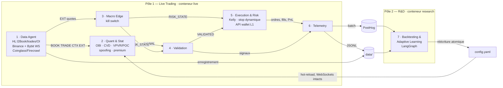

# hl-swarm — essaim multi-agents de trading sur Hyperliquid

Système autonome à 7 agents, dédié aux perps Hyperliquid. Il démarre **sur le testnet, en paper trading** (`dry_run: true`). Le passage en réel exige trois verrous explicites (voir [Sécurité](#sécurité)).

> ⚠️ Ce code n'est pas un conseil financier. La stratégie fournie est un **squelette de recherche** : elle n'a jamais été validée sur des données réelles. Faites-la tourner en paper trading, accumulez des enregistrements de marché, puis laissez l'agent R&D la recalibrer avant de risquer du capital.

## Architecture



**Choix de conception :**

- **Aucun LLM dans le chemin critique.** Du carnet au signal, tout est du numpy déterministe : environ 0,4 ms au p50 dans les tests. Le LLM (Perplexity Sonar) ne sert qu'au radar d'actualité de l'agent Macro. Il tourne en tâche de fond et ne peut **qu'augmenter** le niveau de risque.
- **Une seule implémentation de la stratégie.** `ml_engine/` (features, signal, politique d'entrée/sortie, sizing) est exécuté tel quel par le live **et** par le backtest. Un backtest qui utiliserait un autre code ne dirait rien du live.
- **Bus d'événements en mémoire** avec files bornées et politique « drop-oldest » : un agent lent ne bloque jamais les autres.
- **Stops côté exchange.** SL et TP sont des ordres *trigger reduce-only* posés sur Hyperliquid juste après l'entrée. Ils protègent la position même si le conteneur meurt.

### Correspondance avec le cahier des charges

Les « skills » et « connecteurs » cités dans la demande sont des outils de l'assistant. Ils n'existent pas dans un conteneur déployé. Voici comment chacun est implémenté dans le code :

| Demandé | Implémenté par |
|---|---|
| `build-connector` SDK Hyperliquid | `hyperliquid-python-sdk` (ordres) + WebSocket natif (`core/ws_client.py`) |
| Firecrawl heatmaps/liquidations | API Coinglass officielle (clé), Firecrawl `/scrape` en option (`data.liquidations.provider`) |
| CoinGecko prix Binance/Bybit | WebSockets publics Binance USDⓈ-M + Bybit linear (CoinGecko est trop lent pour du temps réel) |
| `analyze` / `statistical-analysis` | `ml_engine/features.py` (z-scores glissants, OBI, CVD, VPVR, spoofing, premium) |
| Perplexity Computer / `deep-research` | API Perplexity Sonar (`agents/macro_agent.py`) + déclencheurs de marché sans LLM |
| `validate-data` | `agents/validation_agent.py` (règles fail-closed) |
| `variance-analysis` (Kelly, stop) | `ml_engine/risk.py` (Kelly fractionnel avec shrinkage bayésien, stop = k·σ·√t) |
| PostHog `create-viz` / `build-dashboard` | `agents/telemetry_agent.py` (API `/batch/`) + `scripts/posthog_dashboard.py` |
| `explore-data` + backtest | `agents/research_agent.py` (profilage) + `ml_engine/backtester.py` + `optimizer.py` |

## Structure

```
agents/      les 7 agents + brokers (Hyperliquid L1 / Paper)
core/        bus, événements, WebSocket résilient, config + hot-reload
ml_engine/   features, signal, risque, enregistreur, backtester, optimiseur
scripts/     création du dashboard PostHog
tests/       22 tests : unitaires, simulation bout-en-bout, R&D
main.py      orchestrateur (supervision, /health, arrêt propre)
config.yaml  configuration (section strategy rechargée à chaud)
```

## Démarrage rapide

```bash
cp .env.example .env               # renseigner au minimum rien : paper trading testnet
mkdir -p config data && cp config.yaml config/
sudo chown -R 10001:10001 config data   # l'image tourne en utilisateur non-root
docker compose up -d --build
curl -s localhost:8080/status | jq .
```

Sans Docker : `pip install -r requirements-dev.txt && pytest -q && python main.py --role all`.

Backtest ponctuel sur les données enregistrées : `python main.py --backtest`.

## Les 7 agents

1. **Data.** Il s'abonne à `l2Book`, `trades` et `activeAssetCtx` (OI, funding, mark/oracle) pour chaque marché. Il streame aussi les meilleurs prix Binance et Bybit, et récupère la carte des liquidations. Tout est enregistré dans `data/recordings/` pour le backtest. *Limite :* le flux public Hyperliquid fournit **20 niveaux par côté, poussés au plus toutes les 0,5 s**. Pour 100 niveaux, renseignez `HL_BOOK_WS_URL` vers un fournisseur compatible (par ex. Dwellir) ; le paramètre `nLevels` est alors envoyé.
2. **Quant & Stat.** Il calcule un `FeatureVector` par snapshot, exposable en tenseur avec `to_tensor()`, puis un score composite :
   - OBI pondéré, atténué si le côté qui le porte semble spoofé ;
   - pente du CVD ;
   - −z(premium HL vs CEX), pour capter le retard de prix ;
   - retour vers le POC.

   Un signal n'est émis que si le score persiste sur N ticks.
3. **Macro Edge.** Son niveau de risque est le maximum de plusieurs détecteurs : fichier `data/KILL`, fenêtres FOMC/CPI, choc BTC > 2,5 % en 60 s, divergence Binance/Bybit, radar d'actualité par LLM.
4. **Validation.** Il rejette un signal si la macro est en HALT ou son état est inconnu, si les données sont périmées, si le spread est trop large, si le carnet est spoofé du côté du signal, si on courrait après le prix ou si le funding est contraire. Les sorties ne sont jamais bloquées.
5. **Execution & Risk.**
   - Taille : Kelly fractionnel, plafonné à 0,5 % de l'equity risqué au stop, levier ≤ 3, notionnel ≤ 5 000 USD.
   - Ordres : entrée en IOC limitée par `slippage_bps`, puis SL et TP côté exchange.
   - Protections : disjoncteur à −3 %/jour ou 5 pertes consécutives, flatten en cas de HALT, réconciliation toutes les 5 s.
6. **Telemetry.** Il envoie à PostHog chaque ordre (latence), chaque fill (slippage, Kelly, risque) et chaque trade clôturé (PnL, R-multiple), plus l'equity. Les envois partent par lots toutes les secondes, avec une copie JSONL locale.
7. **Backtesting & Adaptive Learning.** Il suit un graphe LangGraph : performance (PostHog via HogQL, ou JSONL) → dégradation ? → profilage des données → optimisation walk-forward dans un process séparé → déploiement.
   - Un candidat n'est accepté que s'il **bat la config actuelle hors échantillon**, s'il est **rentable** hors échantillon et si son **max drawdown est inférieur à 10 %**.
   - Chaque paramètre reste dans `research.bounds` et ne bouge pas de plus de 30 % par cycle.
   - La réécriture de `config.yaml` est atomique et l'ancienne version est archivée dans `config_history/`. `auto_deploy: false` permet de ne faire que des propositions.

## Sécurité

- **Utilisez un API wallet**, jamais la clé du compte principal : app.hyperliquid.xyz → *More → API*. Il peut trader mais **pas retirer**.
- Le trading réel sur mainnet exige **les trois conditions** : `network: mainnet`, `dry_run: false` **et** `LIVE_TRADING_CONFIRM=I_UNDERSTAND_THE_RISKS`. Sinon le process refuse de démarrer.
- La CI refuse tout commit où `config.yaml` n'est pas en `testnet` + `dry_run`. Le mode réel s'active uniquement sur le volume du serveur.
- **Kill switch manuel :** `docker compose exec live touch /app/data/KILL`. Supprimez le fichier pour reprendre.
- Activez des *required reviewers* sur l'environnement GitHub `production` pour valider chaque déploiement à la main.

## Déploiement (GitHub Actions)

Le workflow `.github/workflows/ci-cd.yml` enchaîne : tests et lint → build et push de l'image sur GHCR → déploiement.

- **AWS EC2.** Placez `docker-compose.yml`, `.env` et `config/` dans `~/hl-swarm` sur l'instance. Ajoutez les secrets `EC2_HOST`, `EC2_USER`, `EC2_SSH_KEY` et `GHCR_PULL_TOKEN`. Le conteneur research redémarre d'abord, puis live, et le déploiement échoue si `/health` ne répond pas. Pour la latence, une région proche de l'infrastructure API d'Hyperliquid (généralement indiquée à Tokyo, `ap-northeast-1`) est conseillée ; mesurez-la avant de choisir.
- **Render.** Créez le service depuis `render.yaml`, puis ajoutez le secret `RENDER_DEPLOY_HOOK_URL`. Les deux pôles partagent alors un conteneur (`ROLE=all`), car un disque Render ne s'attache qu'à un seul service.

## Dashboard PostHog

```bash
POSTHOG_PERSONAL_API_KEY=phx_... POSTHOG_PROJECT_ID=... python scripts/posthog_dashboard.py
```

## Ce qu'il reste à faire avant du capital réel

1. Faire tourner une à deux semaines sur le testnet ou en paper pour accumuler des enregistrements réels.
2. Lancer `python main.py --backtest` et lire les résultats hors échantillon, frais inclus : 4,5 bps taker par côté, et un aller-retour coûte environ 9 bps plus le slippage. Sur les données synthétiques des tests, la stratégie par défaut **ne couvre pas ses frais**.
3. Rester conscient que Python + WebSocket public n'est pas du HFT colocalisé : l'avantage visé se situe à l'échelle de la centaine de millisecondes ou de la seconde, pas de la microseconde.
